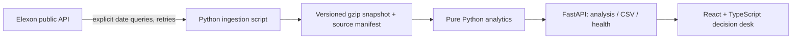

# Technical review

Windledger reconstructs a day-ahead procurement information set, then scores it against subsequently reported wind generation. The main correctness constraint is publication-time selection, not drawing a forecast chart.

## Temporal contract

- January is the **decision month**. There are 31 decisions and 744 next-day delivery hours, January 2 through February 1 inclusive.
- Cutoff is configurable, default 09:00 Europe/London. January and February 1 are GMT; the implementation intentionally scopes timezone arithmetic to this window. Extending across DST requires `zoneinfo`, variable delivery-day lengths, and tests for 46/50 settlement periods.
- WINDFOR includes records for multiple targets per publication. Group by exact target start; select the largest publication timestamp less than or equal to that decision's cutoff. Do not select the latest forecast in the snapshot unconditionally.
- Actuals are retrospective truth, using the most recently published revision present in the downloaded snapshot. They do not influence forecast selection.
- WINDFOR records in this snapshot are hourly. Average two FUELHH observations to obtain mean hourly actual MW. Require both halves. No filling of missing observations.
- Positive error is forecast minus actual: wind overforecast, or a shortfall relative to expected wind. It does **not** imply the utility must buy exactly this much power.

## Data provenance

`scripts/fetch_data.py` requests publication days Dec 31–Jan 31 for forecasts, and settlement days Jan 2–Feb 1 for WIND actuals. The extra publication day supports midnight cutoffs on Jan 1. Queries are split daily with four concurrent workers and bounded exponential retry. Re-fetching is explicit, never tied to a public page request. A failed fetch leaves the previous snapshot intact.

Rows retain `startTime`, `publishTime`, and `generation`. Endpoint and query provenance, counts and retrieval time live in `data/manifest.json`. Its SHA-256 covers the uncompressed compact JSON payload. Identical target/publication keys are deduplicated; the provider's response order has no bearing on eligible vintage selection. Provider revisions can change historical results on a refresh; commit the new manifest and snapshot together after review.

## Metrics

For matched hourly observations, error `e = forecast - actual`, in MW:

| Metric | Calculation | Meaning |
|---|---|---|
| MAE | mean(abs(e)) | Typical absolute miss |
| RMSE | sqrt(mean(e²)) | Sensitivity to large misses |
| Bias | mean(e) | Direction of systematic error |
| WAPE | 100 × sum(abs(e)) / sum(actual) | Volume-normalised error; undefined for zero total actual |
| P90 absolute error | Linear-interpolated 0.9 quantile | Historical tail magnitude |
| Net wind shortfall | sum(e × 1 hour) | Signed MWh; UI converts to GWh |

Never average daily WAPEs into the monthly WAPE. Monthly metrics are recomputed from all paired hourly observations. Missing scores are JSON `null`, not zero. The matched denominator is shown in the UI. Full-month metrics are **retrospective**: using them as a Jan 1 reserve would introduce hindsight leakage. A future product should train/calibrate risk estimates on earlier independent windows and backtest against held-out dates.

## Implementation choices

- React + TypeScript + Recharts, Vite build. Responsive sidebar, keyboard-operable controls, reduced-motion support, loading and retry states.
- Python FastAPI and a small pure analytics module, avoiding pandas for a modest 744-hour scoring problem. Unit tests independently exercise selection and formulas.
- Read-only application: no accounts, write endpoints, database or secret API keys required. Immutable data and bounded in-process LRU caches keep repeated cutoff requests cheap. Sixty-four cutoff results are retained; cold starts reconstruct from a roughly 100 KB compressed snapshot.
- Same-origin `/api` works under Vite proxy, a production Docker container, or Vercel's Python ASGI function. No broad CORS policy is needed.
- The Docker multi-stage build compiles React and serves static output plus API from one unprivileged Python process. `$PORT` is respected for platforms such as Heroku.
- Vercel uses `api/index.py`, route rewrites, and bundled Python/data files. No credentials belong in source control.

## Verification and remaining production work

Tests cover cutoff equality, exclusion one second after cutoff, target alignment, missing half-hours, genuine zeros, actual revisions, input ordering, month boundaries, formulas, CSV parity, validation and real-snapshot coverage. GitHub Actions builds React, runs tests, and builds Docker.

This is an analytical pilot, not automated trading software. A production rollout would add ingestion monitoring, schema validation/conflict detection, archive retention, configurable windows, DST handling, rate limiting, operational SLAs, authentication where needed, and a separate calibrated risk methodology. Utility demand, prices, positions, thermal procurement and embedded-wind corrections are outside the brief's Elexon-only scope.
